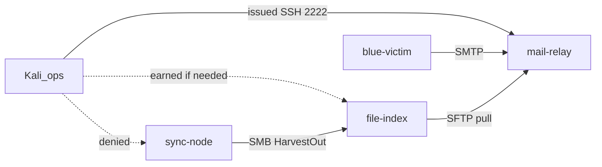

# Break Harvest Collection — Instructor Guide

## Objective and context

Temporary **M07-shaped** placeholder on the harvest cell. Students get a **mail-relay-only** Blue Team Handoff, map how collection works, and **break** it (`degrade` / `disrupt` / `deny`). They may earn file-index by discovering `172.16.4.20` from relay evidence (pickup clears / peer connections), then enumerating Spooler and escalating via PrintNightmare (`printop` / `Printop!01` → SYSTEM). They do **not** get `svc.harvest` credentials in the brief. Sync-node is unreachable. The retired Module is archived at [B04.M07](../../archive/B04.M07-disable-adversary-tooling/).

**Handoff intel clues (instructor only):** The student Blue Team Handoff distributes three contextual terms — `blackstart`, `islanding`, and `N-1` — across plant context, partner document flow, and suspected collection motive. They are ordinary DCO observations for critical thinking, not labeled keywords. Leftover-exec credentials (`admin` / `relayadmin`) are **discoverable on-box** (unit env / script defaults) — do not put them in the brief or on the board; the brief only notes an unevaluated web admin surface. Sync-node keyword reaction **exists** (curated take matching those terms stages a reverse shell on mail-relay `127.0.0.1:1337` for ~30 min). Do **not** brief students on that reaction in M20; required success is still map + break with direct sync-node SSH denied. A keyword-bearing seed may wake the channel as an optional curiosity only.

Walkthrough: [`answer-key.md`](./answer-key.md). Range: [`../../../../environments/b04_temp_harvest_cell/README.md`](../../../../environments/b04_temp_harvest_cell/README.md).

## Dual opening

### Option 1 (Interactive / Whiteboard)

- **Say:** "Lite intro to this range. One issued seat. Figure out how collection works, then break it. If you need another host, find it from relay evidence and enumerate it yourself."
- **Do:** Confirm brief IP is only `172.16.2.10`. Do not post `svc.harvest` password, `printop`, or `172.16.5.30`.
- **Ask (Q):** What is authorized today?
- **Expected Response (A):** Reversible degrade/disrupt/deny against the harvest pipeline; preserve the foothold.

### Option 2 (Slide)

- **Say:** Same as Option 1.
- **Show:** Student-brief tasks and deliverables.
- **Do:** Confirm Moodle `access_key`.
- **Ask (Q):** What is authorized today?
- **Expected Response (A):** Reversible degrade/disrupt/deny against the harvest pipeline; preserve the foothold.

## Instructor resources and pre-class

1. Build/smoke per [`setup-guide.md`](./setup-guide.md) and [BUILD.md](../../../../environments/b04_temp_harvest_cell/BUILD.md).
2. Confirm file-index Spooler is running, null-session enum surfaces `printop`, and your offline PrintNightmare PoC lands SYSTEM.
3. Confirm student SSH to sync-node fails.
4. Issue `access_key` only. Do not put `svc.harvest` / `Harvest!Relay01`, `printop`, or leftover-exec `admin` / `relayadmin` on the board for M20.
5. **Leftover nginx (optional):** nginx listens on `:8080` (`/etc/nginx/sites-available/harvest`) and proxies to `leftover_exec` on `127.0.0.1:8081`. Cleartext Basic auth lives in `systemctl cat leftover_exec` (`EXEC_USER` / `EXEC_PASS`) and defaults in `/usr/local/sbin/leftover_exec.py`. Root-backed allow-list helper — useful for stronger effects, **not** required to map collection. Students discover it; you do not hand it out.

## Facilitation flow

### Step 1: Issue foothold (10 min)

- **Say:** "SSH 2222 to `relay` with the Moodle key. Validate context. The prior cell noted a leftover web admin surface but did not evaluate it — discovery only if you need it."
- **Do:** If a team asks for the `:8080` password, nudge toward listeners → nginx site → `leftover_exec` unit/script on the box. Do not post `admin` / `relayadmin`.
- **Ask (Q):** What foothold did the blue handoff actually transfer?
- **Expected Response (A):** SSH as `relay` on `172.16.2.10:2222` with Moodle `access_key`; no Windows indexer seat.

### Step 2: Map collection (35 min)

- **Say:** "Inventory services, cron, staging. Watch a tick you did not plant. Correct stale DocHarvest / local-cron lies."
- **Do:** If stuck at harvest.cfg, nudge toward `/etc/cron.d/` and `/srv/relay/` without naming peer IPs or passwords.
- **Ask (Q):** If `harvest-forward` is a no-op, what is actually moving mail?
- **Expected Response (A):** Real `mail-process` (or equivalent evidence) encrypts to pickup; something else pulls.

### Step 3: Optional pivot (20 min)

- **Say:** "If you need the indexer to break the path cleanly, watch pickup clear and find who is collecting. Enumerate that host — Spooler is in play. Sync-node is not a seat."
- **Do:** Accept teams that break collection on mail-relay alone (stop smtp_sink, disable mail-process, choke pickup). Accept teams that disable HarvestIndex after PrintNightmare → SYSTEM.
- **Ask (Q):** Why might stopping only nginx be a weak effect?
- **Expected Response (A):** Collection may not use leftover HTTP; SMTP/processor still runs.

### Step 4: Execute and validate (45 min)

- **Say:** "Fire the effect. Wait a cycle. Prove take stopped. Keep SSH working."
- **Do:** Stop destructive wipe of transit keys without documenting reversibility. Snapshot restore if a team bricks the seat.
- **Ask (Q):** What proves the break vs random silence?
- **Expected Response (A):** Before/after staging or outbox evidence tied to the action.

### Step 5: Collect reports (15 min)

- **Say:** "Five-line effect report. Name the doctrinal effect."
- **Do:** Grade from the answer-key checkpoints.

## Timing

About 150 minutes. Protect foothold preservation and no sync-node login.

## Common stalls

- `chmod 600` on `access_key`.
- Trusting DocHarvest / `D:\Harvest` as truth.
- Asking for Windows password — nudge pickup observation / peer enum / Spooler, not the board.
- Asking for leftover `:8080` password — nudge `ss` → nginx harvest site → `systemctl cat leftover_exec` / `/usr/local/sbin/leftover_exec.py`.
- Trying sync-node — expect fail; grade the note, not a shell.

## Lesson summary

Map the harvest path from a thin foothold, break collection cleanly, keep the seat for poison work later.

## Questions and check on learning

- **Ask (Q):** What must the packet contain tomorrow that you were not given today?
- **Expected Response (A):** Issued indexer access (and what it filters) — or confirmation you already earned SYSTEM on it.

## Related artifacts

- Student brief: [`student-brief.md`](./student-brief.md)
- Setup: [`setup-guide.md`](./setup-guide.md)
- Verify: [`verification-runbook.md`](./verification-runbook.md)
- Answer key: [`answer-key.md`](./answer-key.md)
- Range breakdown: [`instructor-range-breakdown.md`](./supporting-documents/instructor-range-breakdown.md)
