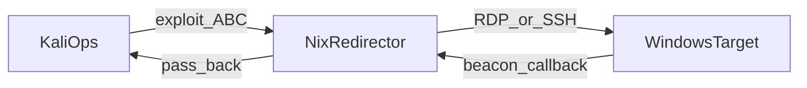

# Threat-Rep Mission Rehearsal Lab — Instructor Guide

## Objective and context

Students build a lean **Kali → vulnerable *nix redirector (A/B/C) → Windows** range and rehearse exploit → lateral (RDP/SSH) → C2 callback **through** the redirector. The retired Module is archived at [B04.M02](../../archive/B04.M02-threat-rep-mission-rehearsal-lab/).

Walkthrough and per-option setup/exploit detail: [`answer-key.md`](./answer-key.md).
Shared cluster contract: [`../../../../environments/effects_lab_env/vsphere/README.md`](../../../../environments/effects_lab_env/vsphere/README.md).

## Dual opening

### Option 1 (Interactive / Whiteboard)

- **Say:** "Build three hosts. Pick redirector A, B, or C from the brief. Exploit it, reach Windows, and prove the beacon comes home through the middle box — not around it."
- **Do:** Confirm each student has a folder, `/29` slip, and the student brief. Do not project answer-key PHP/CGI/Tomcat setup.
- **Ask (Q):** What three roles must exist before rehearsal is honest?
- **Expected Response (A):** Kali ops, dual-homed vulnerable redirector, Windows target with callback through the redirector.

### Option 2 (Slide)

- **Say:** Same as Option 1.
- **Show:** Student-brief topology and the three option cards.
- **Do:** Confirm vCenter access.
- **Ask (Q):** What three roles must exist before rehearsal is honest?
- **Expected Response (A):** Kali ops, dual-homed vulnerable redirector, Windows target with callback through the redirector.

## Instructor resources and pre-class

1. Prep per [`setup-guide.md`](./setup-guide.md) and smoke per [`verification-runbook.md`](./verification-runbook.md).
2. Confirm ISO/template catalog covers Ubuntu LTS, Debian, Rocky or Alma, Kali, and a Windows Server/Desktop image suitable for RDP (OpenSSH optional).
3. Issue `/29` assignments; post gateway/DNS.
4. Keep answer-key credentials and exploit commands off the board.
5. Grade OE rationale, path fidelity, friction/limits, and documented compromises — not a single flag string.

## Facilitation flow

### Step 1: OE selection and option pick (20 min)

- **Say:** "Write what you will build and what you will cut. Pick A, B, or C and defend it in one sentence."
- **Do:** Spot-check that students are not planning vanity fourth hosts.
- **Ask (Q):** Why is a second unused Windows client usually a cut?
- **Expected Response (A):** It does not change the exploit → lateral → pass-back decision.

### Step 2: Build (75 min)

- **Say:** "Dual-home the redirector. Keep Kali and Windows addressing inside your `/29`. Snapshot before you break networking."
- **Do:** Help with vSphere NIC/order issues; do not hand out gold configs.
- **Ask (Q):** Which NIC faces ops and which faces Windows — and how will you prove it?
- **Expected Response (A):** Ops-facing holds the exploit surface; private NIC reaches Windows; diagram + ping/RDP evidence.

### Step 3: Rehearse path (50 min)

- **Say:** "Exploit your chosen surface. Reach Windows. Place a beacon that must traverse the redirector. Inject friction and vary one bound."
- **Do:** If a team shows a direct Windows→Kali callback, call it a different TTP and require pass-back.
- **Ask (Q):** If the beacon arrives without touching the redirector, what did you rehearse?
- **Expected Response (A):** Direct callback — not the SOM under test.

### Step 4: AAR / collect deliverables (20 min)

- **Say:** "Hand in rationale, diagram, RAM table, snapshots, rehearsal script, and AAR with compromises."
- **Do:** Collect products; note option chosen per student for answer-key comparison.
- **Ask (Q):** Name one compromise that bounds how far you can read a green result.
- **Expected Response (A):** Facilitation — Windows build stand-in, lab-only creds, single forwarder tool, etc.

## Common failure modes

| Symptom | Likely cause | Instructor nudge |
| --- | --- | --- |
| RCE works; no Windows reach | Single-homed redirector or wrong private route | Check dual NIC, routes, Windows firewall/RDP |
| Beacon on Kali with no redirector logs | Direct callback shortcut | Require forwarder evidence on middle hop |
| Comfort SSH on ops-facing redirector | Path fidelity break | Send back to option surface (PHP/CGI/Tomcat) |
| RAM over ~50 GB | Vanity clones left powered on | Power off unused VMs; resize |

## Lesson summary

- Success = justified lean OE + honest path + friction/limits + compromises.
- Per-option how-to lives only in [`answer-key.md`](./answer-key.md).

## Questions and check on learning

- **Ask (Q):** What proves pass-back?
- **Expected Response (A):** Beacon traffic observed traversing the redirector forwarder to Kali — not only a listener hit with no middle-hop evidence.
- **Ask (Q):** Why keep option reconstruct inventories free of exploit steps?
- **Expected Response (A):** Students practice building from inventory; instructor key holds setup/exploit for cadre use.
